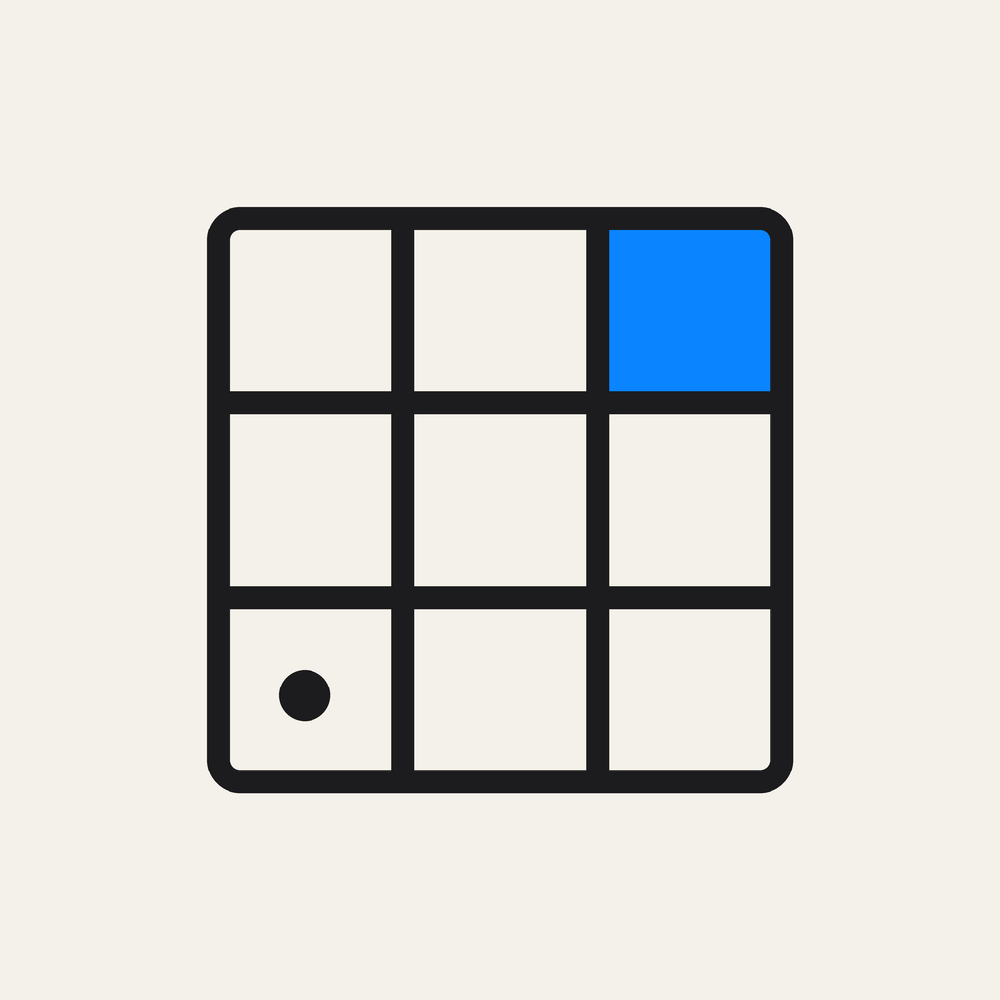

# 数独

一个从零手写的原生 iOS 数独游戏。**Objective-C + UIKit，零第三方依赖，零配置工程**——
没有 Xcode 工程、没有 CocoaPods、没有 Swift Package，只有 16 个 `.m` + 15 个 `.h`，
用 `clang + ld64.lld` 就能直接在命令行里编出可安装的 `.ipa`。

界面按 **Apple Human Interface Guidelines** 搭：系统字体、语义色、`UITableView` 的
inset-grouped 列表、`UIButton.Configuration`、`UIAlertController`、SF Symbols，
自动跟随系统浅色 / 深色外观，并支持动态字体缩放。



## 为什么这一版看起来像系统应用

上一版试图自己"发明"一套液态玻璃：自绘渐变描边、极光背景、霓虹高光。结果是浮夸、对比度差、
和系统割裂。这一版把它全部删掉，换成 Apple 手册里现成的东西：

| 位置 | 用的什么 |
| --- | --- |
| 首页 | `UITableViewStyleInsetGrouped` + `UIListContentConfiguration`，与「设置」同构 |
| 导航 | 标准 `UINavigationController`，大标题、系统返回箭头、SF Symbols 工具栏按钮 |
| 棋盘 | 一张圆角卡片，语义色绘制，发丝分隔线 + 1.5pt 宫线 |
| 按钮 | `UIButton.Configuration` 的 tinted / gray / filled，按下态由系统负责 |
| 设置 | 分组列表 + `UISwitch` 作为 `accessoryView`，危险操作单独红色居中一行 |
| 暂停 / 通关 | `UIAlertController`，不做自制浮层 |
| 配色 | 全部语义色：`label`、`secondaryLabel`、`separator`、`systemBlue`、`systemRed` |
| 外观 | 浅色 / 深色自动切换（`traitCollectionDidChange` 里重绘） |

## 功能

- **三种难度**：简单 44 / 中等 32 / 困难 24 提示数，位掩码 + MRV 回溯生成，**每局校验唯一解**
- **放大镜**：按住棋盘拖动，手指上方浮起 2.1× 圆形放大镜，按矢量重绘当前格子（不是截屏放大，不糊）
- **笔记**：笔记模式、一键填满全部候选、自动清除关联笔记
- **撤销 / 重做**：可回溯 120 步
- **提示**：自动挑最该填的格子并高亮
- **冲突提示**：同行列宫重复标红、可选即时判错、失误计数
- **计时与暂停**：切到后台自动暂停并自动存档，回到前台询问是否继续
- **历史与统计**：每局记录（可左滑删除）、最佳 / 平均用时、完成率、最近七天柱状图
- **断点续玩**：退出不会丢进度，首页第一行就是「继续对局」
- **触感反馈**、动态字体、VoiceOver 标签

## 编译（不需要 Mac、不需要 Apple 账号）

需要 Linux / WSL 上的 `clang`、`ld64.lld` 和一份 iPhoneOS SDK（例如 theos 的 `sdks`）。

```bash
# 只做语法与警告检查
bash scripts/check.sh

# 编译 arm64 未签名 ipa（产物在仓库根目录）
bash scripts/build-ios.sh
```

脚本做的事：`clang -c` 编译全部 `.m` → `ld64.lld` 链接成 Mach-O（arm64，最低 iOS 15）
→ 组装 `Payload/Sudoku.app/` → `zip` 成未签名 `.ipa`。框架（UIKit / Foundation / CoreGraphics /
QuartzCore）由脚本按源码里的 `#import` 自动补 `-framework`。

图标由 `scripts/make_icon.py` 用 Pillow 精确绘制并导出全部尺寸（扁平、无圆角、无透明）。

## 安装

ipa 未签名，任选一种方式自签安装：

- **TrollStore**（支持的系统直接安装）
- **ESign / Feather**：用自己的 p12 重签后安装
- **Sideloadly / AltStore**：Apple ID 签名，7 天有效

## 目录

```
Sudoku/
  main.m                    程序入口
  SDKAppDelegate.{h,m}      窗口 + 导航控制器
  SDKHomeViewController.*   首页（inset-grouped 列表）
  SDKGameViewController.*   对局页（棋盘、键盘、计时、暂停/通关）
  SDKHistoryViewController.* 历史与统计（分段控件 + 两个列表 + 柱状图）
  SDKSettingsViewController.* 设置（分组列表 + 开关）
  SDKBoardView.*            9×9 棋盘绘制与触摸（同时供放大镜复用）
  SDKLoupeView.*            圆形放大镜（矢量重绘）
  SDKBarChartView.*         最近七天柱状图
  SDKSudokuEngine.*         题目生成 / 求解器（纯 C 内核）
  SDKGameState.*            一局的状态、笔记、撤销栈
  SDKStore.*                NSUserDefaults 持久化：设置、存档、历史、统计
  SDKTheme.*                语义色、字体、触感、格式化
Resources/                  Info.plist 与图标
scripts/                    check.sh、build-ios.sh、make_icon.py
```

## 已知限制

- 没有用 iOS 26 SDK 编译（本机是 Windows + WSL，只有 iOS 16.5 SDK），所以系统级
  液态玻璃材质在 iOS 26 上不会由系统渲染；这也是这一版改用系统标准组件的原因——
  它在任何 iOS 版本上都和在系统里长出来的一样。
- 仅竖屏；iPad 上内容宽度限制在 520pt 以保证可读性。

## 许可

MIT，见 [LICENSE](LICENSE)。
